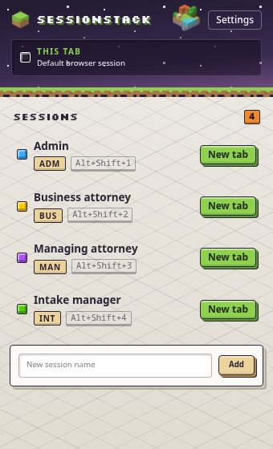
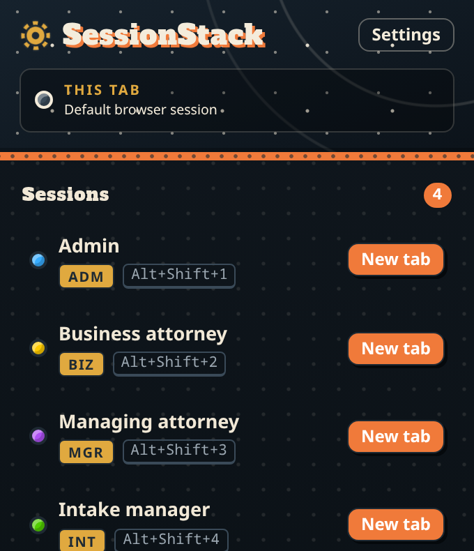
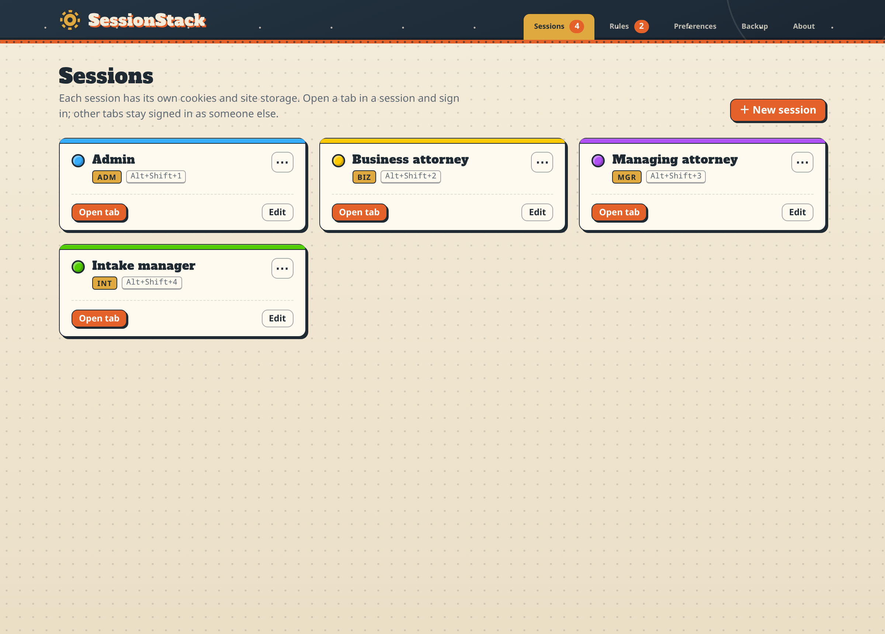
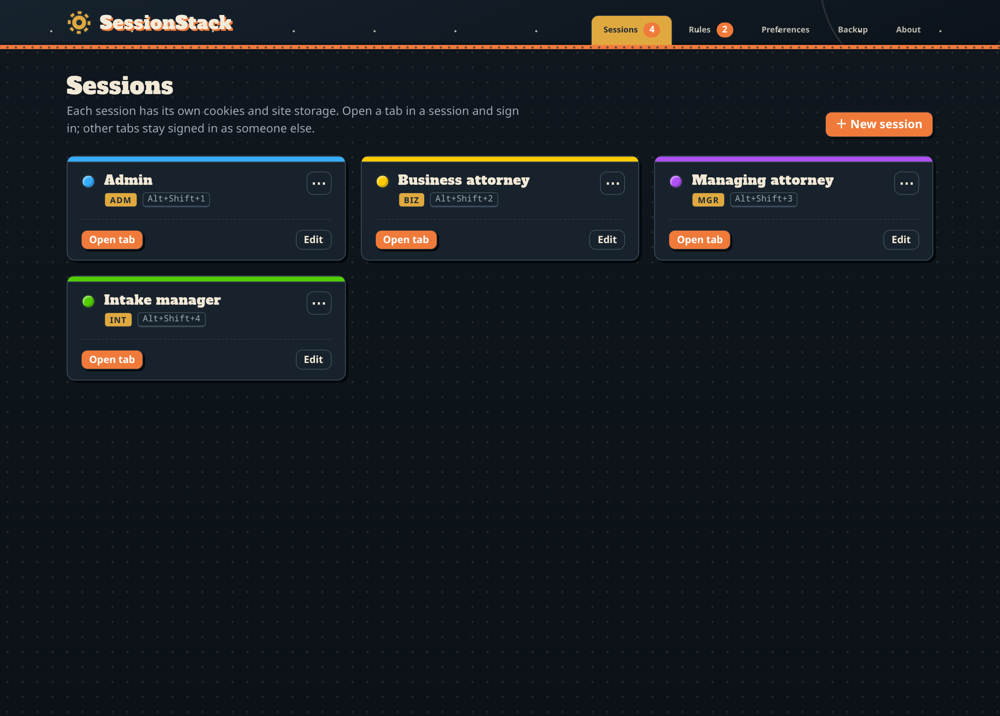
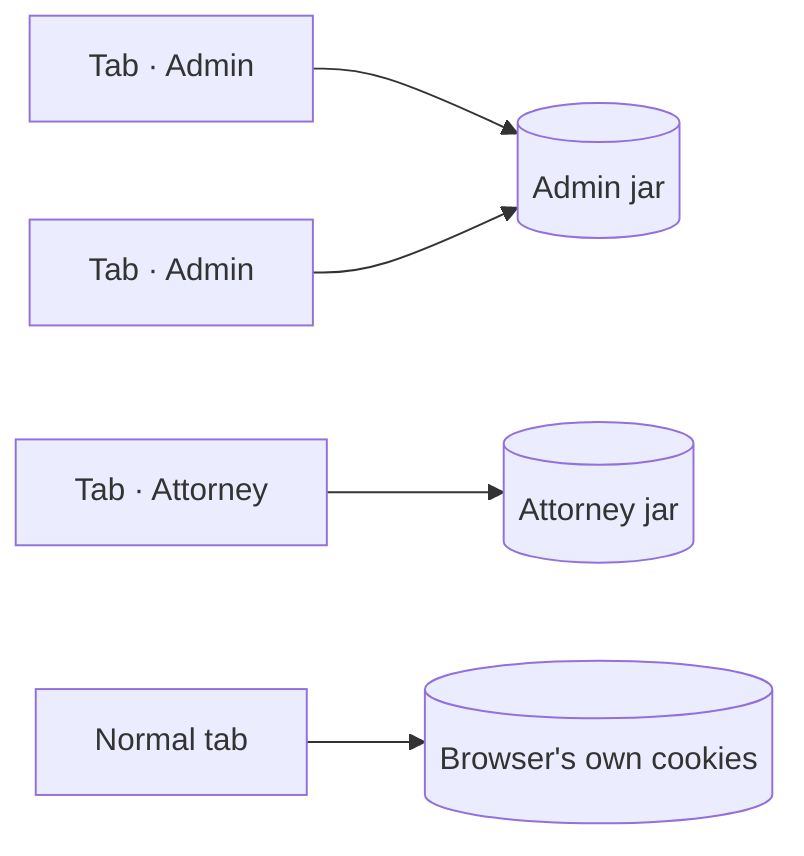

<div align="center">


# SessionStack

**Several logins to the same site, side by side in one window.**

Every tab belongs to a *session* with its own cookies and site storage. Keep the production admin in one tab, a staging developer in the next and a client QA account in a third, with no private windows and no extra browser profiles.



&nbsp;&nbsp;


</div>

---

## Features

| | |
|---|---|
| 🗂️ **Sessions per tab** | Open a new tab in a session, or move the current tab into one, from the toolbar popup. A session can have as many tabs as you like, and they share one login. |
| 🔒 **Real isolation** | Each session gets its own cookies, `document.cookie`, `cookieStore`, `localStorage` and `sessionStorage`. |
| 💾 **Saved tabs** | Each session remembers its tabs. Close its group, its window or the browser, then click **Open** in the popup to get the same pages back, still signed in. If the tabs are already open, the button says **Show** and switches to them. |
| 🏷️ **Tab groups** | In Chrome, each session's tabs sit in a tab group labelled with the session's full name and colour. Drag a tab into a group to move it into that session; drag it out to return it to the default session. |
| 💡 **Marked tabs** | The site's tab icon gets the session's coloured lamp, and the title gets the session tag, e.g. `[ADM] Dashboard`. The toolbar badge shows the tag too. |
| 🧭 **Auto-session rules** | URL globs such as `*.staging.example.com` or `https://example.com/admin/*` send navigations into a session automatically. |
| 🔗 **Inherited pop-ups** | Links and pop-ups opened from a session tab stay in that session. |
| 🔐 **Encrypted backup** | Sessions, rules and cookies are exported to a passphrase-protected file (PBKDF2-SHA-256 with 600k iterations, then AES-GCM-256). On import you can merge or replace. |
| ⌨️ **Hotkeys** | `Alt+Shift+1…4` open a new tab in the first four sessions. |
| 🌗 **Light and dark** | A voxel diorama theme: block-built buttons and cards on a pale studio floor by day, a dusk-purple sky by night. |

<div align="center">

<br /><br />

</div>

## Install

Ready-made builds are in [`release/`](release/).

**Chrome, Edge, Brave and other Chromium browsers**
1. Open `chrome://extensions` and turn on **Developer mode**.
2. Click **Load unpacked** and pick `release/chrome-mv3`.
   (Or install `release/sessionstack-0.4.0-chrome.zip` through a store or your browser's policy tools.)

**Firefox 140+**
1. Open `about:debugging#/runtime/this-firefox`.
2. Click **Load Temporary Add-on…** and pick `release/firefox-mv3/manifest.json`.
   (`release/sessionstack-0.4.0-firefox.zip` is the package for addons.mozilla.org, with `sessionstack-0.4.0-sources.zip` as its source upload.)

## Using it

1. Click the toolbar icon and add a session, e.g. *Attorney*.
2. Click **Open** next to it and sign in. That login now belongs to the session.
3. Add another session and sign in as someone else. Both stay signed in, side by side.
4. Open **Settings** to rename sessions, change their badge and colour, set up auto-session rules, adjust preferences or back up everything.

## How it works

Think of each session as **its own cookie jar**, and each tab as wearing a **name tag** that says which jar it uses.



Both engines sit behind one interface in `src/engines/engine.ts`.

**Firefox** maps each session to a native container (`contextualIdentities`). The browser itself isolates cookies, storage and IndexedDB. Rules are enforced with a blocking `webRequest` listener that reopens the URL in the right container.

**Chrome** has no containers, so SessionStack keeps its own RFC 6265 cookie jar per session (`src/engines/chromium/`):

- A non-blocking `webRequest.onHeadersReceived` listener (`extraHeaders`) stores each response's `Set-Cookie` in the session jar.
- The jar is compiled into `declarativeNetRequest` session rules scoped to the session's `tabIds`:
  - A fail-closed base rule removes the browser's own `Cookie` header and strips `Set-Cookie`, so the real jar is never touched.
  - Per host/path/scheme/SameSite rules set the jar's `Cookie` header.
- The same rules stamp a `Server-Timing` response header with the session key and the script-visible cookies.
- A MAIN-world content script (`entrypoints/shim.content.ts`) reads that header synchronously at `document_start`, before any page script runs. It then serves `document.cookie` from it and namespaces web storage per session.
  - On plain-http pages `Server-Timing` isn't exposed. The shim falls back to a per-tab cache that the isolated-world bridge keeps up to date, and the bridge reloads once if the cache was wrong.
- Auto-session rules compile to DNR redirects through `switch.html`. The tab joins the session *before* the first request is sent.
- Login flows where a redirect races the rule update are detected. The extension compares the `Cookie` header that was actually sent with the jar, and reloads the page when they differ.

**Tab marking (Chrome).**
- **Tab groups:** groups are created and labelled by `src/engines/chromium/groups.ts`. Only groups the extension created are ever changed.
- **Favicon:** the badged icon is drawn in the service worker with `OffscreenCanvas`. If a site's `img-src` CSP refuses the generated icon, the bridge switches to a plain lamp icon shipped in `public/favicon/`, because extension files aren't covered by the page's CSP.

## Known limitations (Chrome)

- **Not isolated:** IndexedDB, Cache Storage and site service workers (requests from a service worker have no tab). On these, partitioned tabs share data with the default session.
- **Pop-ups and links:** a tab opened from a session tab (with the "inherit" preference on) may send its first request with default-session cookies before it is moved and reloaded.
- **Restarts:** after a browser restart, session tabs are matched back by URL and position. Unmatched tabs fall back to the default session. This is safe: no cookies cross between sessions.
- **Rule budget:** Chrome caps regex rules at 1000. Sessions with cookies for very many hosts stop sending cookies to their oldest hosts first (fail-closed), and a warning is logged.
- **Storage on disk:** session jars are kept unencrypted in the extension's local storage, like the browser's own cookie store. Export files are encrypted.
- **Saved tab groups:** Chrome saves every tab group to the bookmarks bar. To hide them, right-click the bookmarks bar and untick **Show tab groups**, or turn off *Group tabs by session* in Preferences.
- **Tab icons:** on sites with a strict `img-src` CSP, the tab shows the plain session lamp instead of the site's own icon with the lamp.

## Development

```sh
pnpm install
pnpm dev               # Chrome with hot reload
pnpm dev:firefox       # Firefox
pnpm build             # .output/chrome-mv3
pnpm build:firefox     # .output/firefox-mv3
pnpm zip && pnpm zip:firefox   # store packages
```

### Tests

```sh
pnpm compile           # type-check
pnpm test              # unit tests (Vitest): rules, crypto, cookie jar, DNR compiler, page shims
pnpm test:e2e          # builds, then drives Chromium with the extension against a local test server
```

The end-to-end suite (`tests/e2e/`) needs Playwright's Chromium (`pnpm exec playwright install chromium`). It covers:
- two simultaneous logins on the same site
- the real cookie jar staying clean
- `document.cookie` at inline-script time
- script-set cookies
- web-storage namespacing
- login redirects
- auto-mapping on a non-secure origin
- pop-up inheritance
- export → clear → import

There is no automated Firefox run yet. Use `pnpm dev:firefox` and check the same flows by hand. `pnpm exec web-ext lint -s .output/firefox-mv3` validates the package.

## Layout

```
entrypoints/
  background.ts          service worker: state, API, badges, favicons, tab groups, hotkeys
  popup/  options/       Preact UI
  switch/                auto-mapping redirect target (Chrome)
  shim.content.ts        MAIN-world cookie/storage shim (Chrome)
  bridge.content.ts      isolated-world bridge between shim and background (Chrome)
src/core/                types, storage, messaging, URL rules, crypto, favicon drawing
src/engines/chromium/    cookie jar, DNR rule compiler, tab groups, engine
src/engines/firefox/     container engine
src/page/                storage proxy and cookie view used by the shim
src/ui/                  theme, fonts, glass-scroll scrollbars, shared UI helpers
public/favicon/          per-colour lamp icons (CSP fallback)
release/                 built Chrome and Firefox packages
```

The scrollbars use [glass-scroll](https://github.com/sami999khan999/glass_scroll).
